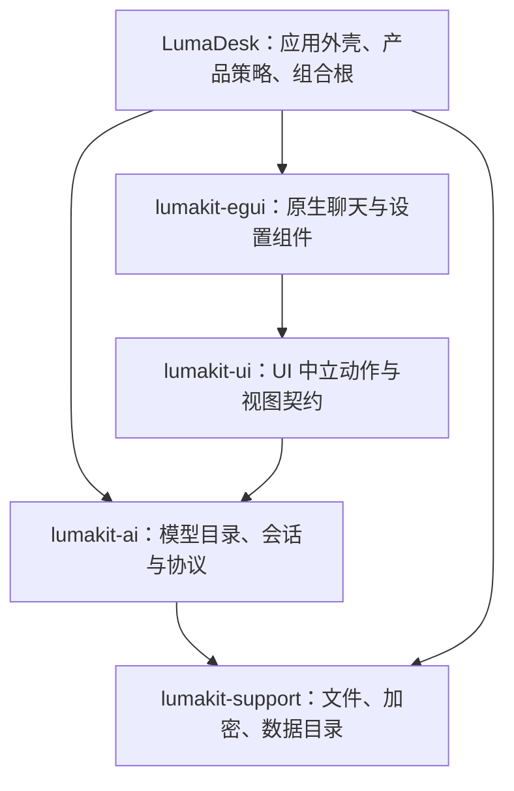

# AI 对话移植与 LumaKit 复用设计

状态：新项目聊天能力总设计，现有文本聊天链路是基线实现，高级聊天能力按本文继续落地。执行状态见 [聊天功能任务追踪](06-聊天功能任务追踪.md)。日期：2026-10-24。当前实现、差异和验证边界见 [详细设计](02-AI对话移植详细设计.md)。

本文是新项目的产品与架构设计，不把当前代码缺口当成产品边界。参考 AutoNote/Aether 的已运行行为，但允许重做数据模型、事件链和宿主接缝；目标是把聊天能力完整落到 LumaKit 与 LumaDesk，而不是只修复一版文本聊天界面。

## 1. 决策与范围

1. 参考 AutoNote 实际使用的 `@ouraihub/aether-ui`，迁移信息结构、交互约束和排版规则，原生绘制仍用 egui；参考项目不是实现边界。
2. 产品目标包含文本流式、回答候选树、编辑/删除/分支/选择、翻译、联网来源、工具与推理状态、用量计费、图片附件和生成图片；每项都必须有真实请求、事件、持久化和显示链路。
3. 通用模型、运行时、事件归约、历史和媒体引用归 LumaKit；egui 组件独立放在 `lumakit-egui`，不让 UI 中立层依赖 egui。
4. LumaDesk 负责组合、主题、模型目录、产品策略和笔记等宿主动作；基础聊天能力不反向依赖业务页签或笔记数据库。
5. 这是新项目，允许按目标能力重做 API 和 `chat.db` schema；只为已有用户数据提供显式导入/迁移，不为保留旧实现而冻结新能力。
6. 每个功能必须完成“用户动作 → 请求 → 运行事件 → 会话状态 → 持久化 → UI 恢复”的纵向链路；没有真实链路就不显示入口，不用占位按钮冒充完成。

初始文本链路和现有数据可作为迁移基线，但不是最终产品合同。实现按下方阶段推进，阶段之间保持可运行，不要求一次生成所有抽象接口。

## 2. 阅读依据与证据边界

### 2.1 来源约定

- `A/` = `E:/workspace/notepad-dev/AutoNote/`。
- `U/` = `A/node_modules/@ouraihub/aether-ui/src/`，是当前安装的实际组件源码，不是只看 AutoNote 包装层。
- `D/` = LumaDesk 项目根。
- `K/` = 相邻 LumaKit 项目根。

AutoNote `packages/app/package.json` 中的 UI 依赖固定到 Aether 提交 `84a643c6d97ded4c29b9b0a5c14adf534ff32d5c`。以下行号对应本次本地快照，后续改动以文件和符号为准。

### 2.2 已读关键路径

| 阅读对象 | 依据 | 本文采用的事实 |
| --- | --- | --- |
| AutoNote 宿主包装 | `A/packages/app/src/features/ai/chat/ChatPanel.svelte:14–66` | 按笔记生成 scope/context；记住会话、工具栏和思考设置；实际 UI 由共享组件提供 |
| 聊天布局 | `U/chat/ChatPanel.svelte:694–837,1398–1497` | 头部、可滚动消息、底部 composer 三段；历史通过头部弹窗进入 |
| 输入与工具栏 | 同文件 `901–919,1247–1270,1541–1554` | 输入和工具栏同容器；发送/停止互换；Ctrl/Cmd+Enter 排除输入法组合与重复按键 |
| 消息表现 | `U/chat/MessageItem.svelte:159–214,214–373,443–568` | 用户消息靠右；助手块含来源、正文、动作、终态；Markdown 有独立排版 |
| 会话状态 | `U/chat/run-session.svelte.ts:132–168,210–300,329–519` | 候选回答分组、取消、accepted/end、历史回读、过期事件守卫 |
| 模型选择 | `U/providers/ModelSelect.svelte:79–214,227–249` | 搜索、分组、能力过滤、失效模型状态；名称优先，分组信息弱化 |
| 端口与 DTO | `U/ports/contract.ts:51–92,127–137`；`generated/RunRequest.ts,RunEvent.ts,Turn.ts` | UI 不直接拥有业务存储；缺失能力可以不出现；每轮只有一个终态 |
| 样式 | `U/styles/tokens.css:3–10`；`A/packages/app/src/styles/{tokens,ui}.css` | 统一控件尺度，组件颜色映射到宿主主题，而非照用组件默认配色 |
| 当前原生聊天 | `D/src/chat.rs:12–95,109–276,278–488` | 数据、网络线程、保存和绘制混在同一组件 |
| 当前框架 | `K/crates/lumakit-ai/src/{lib,history,providers}.rs`；`lumakit-ui/src/{lib,ai}.rs`；`lumakit-support/src/{lib,sqlite}.rs` | 协议可复用；历史结构不一致；UI 契约尚未承载真正的聊天组件 |

已阅读的是上述关键路径与相关函数，不宣称完整逐行审计 Aether 所有功能。本次没有启动 AutoNote 做视觉对照，没有运行构建或测试；参考外观来自实际模板/样式，当前重叠来自用户截图，根因分析来自原生布局源码。实施时必须补实窗验收。

### 2.3 许可边界

已安装的 `@ouraihub/aether-ui/package.json` 没有 license 字段，包目录未找到 LICENSE；仅凭此不能确认上游完整授权条件。AutoNote 的许可也不能自动等同于 Aether 的许可。本文描述行为与设计事实，不复制组件实现。若实施中需要直接搬运代码、资源或文案，应先核对上游仓库许可及保留义务；不能因“可以读取”就认定可以按 LumaKit 的 MIT/Apache 声明重新发布。

## 3. 不是颜色不同，而是结构与职责不同

### 3.1 用户看到的重叠

`D/src/chat.rs:323–357` 在 `bottom_up` 布局中嵌套 `vertical`，再把 `available_height()` 交给消息 ScrollArea。输入区没有通过真正的底部面板从剩余消息矩形中扣除。`vertical` 本身又采用 top-down 子布局；egui 的 scope 在子内容完成后按实际 min_rect 推进父游标。

用户截图已经证明消息、占位文字和输入框覆盖。上述组合是需要替换的布局边界；具体每帧矩形变化尚未实测，不能把推测写成已复现的唯一触发条件。不是添加空白、调大 max_height 或裁掉文字就能解决的问题。

### 3.2 对照结果

| 层面 | Aether / AutoNote | 当前 LumaDesk | 移植决定 |
| --- | --- | --- | --- |
| 空间分配 | 消息填充余高，composer 不收缩 | 反向布局混合正向子布局 | 原生面板先分配头尾，余下给消息 |
| 会话导航 | 头部历史弹窗、新会话入口 | 常驻窄侧栏 | 改为历史弹窗，正文不再被二次分栏 |
| 角色区分 | 用户气泡与助手内容块 | 共用 label 渲染函数 | 分成两种消息呈现，不改消息正文 |
| 来源与操作 | 模型来源弱化，动作在回答后 | 尝试次数、状态、复制混在标题 | 来源、正文、状态、操作分层 |
| 正文 | Markdown，段落/代码/表格有节奏 | 普通 Label | 增加原生 Markdown，不引入 WebView |
| 模型 | 可搜索分组，名称/来源分层 | 长串路径式 ComboBox | 结构化 ModelOption 和分组搜索 |
| 输入 | 独立带边框容器，右侧发送/停止 | 输入、发送、重新生成混排 | 重试归回答；composer 只管新输入与停止 |
| 上下文 | 选择的候选及祖先链 | 每个问题只认最后一个 attempt，且必须完成 | UI 迁移先保留原规则；候选选择另作语义升级 |
| 框架 | 端口、状态、控件、宿主分离 | 组件直接依赖 ModelSettings 与文件 | 提取真实核心和原生适配层 |

特别注意：当前 `context()` 不是“从所有尝试中寻找最后成功项”，而是只检查 `attempts.last()`。末次重试失败时，之前成功的尝试不会进入后续上下文。移植时不得暗改为另一种选择规则。

## 4. 目标聊天设计

### 4.1 页面与空间合同

- 保留 LumaDesk 现有应用栏和页签；聊天区域内部不再保留永久历史侧栏。
- 头部第一行：会话标题，右侧历史、新对话；第二行：模型选择，设置入口纳入模型选择底部或紧邻但不抢宽。
- 中部：唯一消息滚动区域。空状态、模型无效提示和回答都在明确区域中显示。
- 底部：输入正文与工具栏组成单一 composer；占位高度先从聊天区域扣除。
- 错误/保存失败提示有独立可见位置，不作为消息区背后的浮层。

原生实现选择：在聊天 child Ui 内使用嵌套的 `TopBottomPanel::top/bottom(...).show_inside`，随后只在余下矩形放 transcript。不得再用反向 scope 模拟底部布局。面板 ID 按组件实例隔离；若内部误差必须手工分配矩形，仍由一个位置负责划分，不能两块分别猜测高度。

不变量：`header.bottom <= transcript.top`，`transcript.bottom <= composer.top`；所有区域都在宿主分配矩形内；输入区内部也不能让长错误提示挤掉发送按钮。

### 4.2 排版与尺度

下表的“参考”是 CSS 逻辑尺寸，“原生目标”是 egui 逻辑 point，不直接拿屏幕物理像素作等号。

| 项目 | 参考 | 原生目标 |
| --- | --- | --- |
| 正文字号 | 13px | 13pt 起，结合 Windows 字体实窗校准 |
| 辅助信息 | 12px | 12pt，模型来源/快捷键弱化 |
| 正文行高 | 1.6 | 明确行距，中文不依赖默认紧密行盒 |
| 控件高度 | 28–30px | 28–30pt，统一按钮/模型选择 |
| 轮次间隔 | 16px | 16pt |
| 助手块内边距 | 12px | 12pt |
| 用户块内边距 | 10px / 12px | 10pt / 12pt |
| 基础圆角 | 8px | 8pt；composer 12pt |
| composer 输入正文 | 默认 80px | 默认约 80pt，内容超长内部滚动 |
| 输入展开 | 容器高度 40% | 可展开到聊天可用高度约 40%，始终留出消息和工具栏 |

只维护一套语义主题值：正文、次级文字、背景、助手底、边界、强调色、错误色、焦点。复用宿主浅深色切换，不把 AutoNote 的所有主题色和皮肤选择器都复制进来。正文不能长期使用次级文字色；按钮必须有默认、悬停、焦点、按下、禁用状态。

### 4.3 消息与动作

- 用户：右对齐、有限宽度的主题色气泡，保留用户输入换行；长词允许断行。
- 助手：内容块左对齐，模型来源小字；正文占主位。完成状态不和每段内容竞争。
- 复制、重试、编辑、删除、分支、选择、翻译、来源、附件和宿主动作只在对应后端能力真实接通后显示。
- failed/cancelled 保留已收到文本；中断有明确标识。未完成流不得伪装成已完成。
- 普通回复、代码块、表格应允许选择与复制；复制仍返回原始 Markdown，不能是丢失格式的渲染文本。

### 4.4 Markdown

实现前评估兼容 egui 的成熟原生渲染器，检查许可、依赖和真实控件行为后选定；不手写 Markdown parser，也不为此接入浏览器。

最低验收：标题、段落、粗体、列表、引用、链接、行内代码、代码块、表格、中文长文本、流式未闭合代码围栏。代码块/表格只在自身横向滚动，聊天区域不被撑宽。禁用原始 HTML、脚本、自动远程图片获取；链接点击仅允许 HTTP(S)。保持源文本作为存储与复制的唯一来源。

### 4.5 滚动、输入与状态

- 消息区与长输入框各自滚动，滚轮命中哪个区域就操作哪个区域。
- 在底部时跟随流式；用户向上阅读时停止追随，显示“回到底部”。点击后恢复跟随，不能用不可见的强制 scroll 每帧抢位置。
- 发送后跟随最新回复；新会话为空状态；重启恢复已选会话、草稿和模型，不把已发送问题又塞回输入框。
- Enter 换行，Ctrl+Enter 发送；输入法组合期间和按键自动重复不提交。当前 egui 对 IME 的具体事件映射需实施时验证。
- 生成中发送位置变为停止，重复发送受状态守卫；停止到终态和落盘完成前不释放关键操作锁。
- 无模型、模型被停用/删除、历史载入失败、历史保存失败分别反馈；不把这些状态都降级为空白页。
- 关闭窗口先取消/收尾并完成保存；失败继续留在可恢复页面。普通切换应用不丢失正在生成的结果。

## 5. Aether 行为如何迁移，哪些不机械照搬

参考行为按目标数据模型转换；候选树、翻译、搜索、工具、推理、图片和宿主动作不是“以后再决定”的产品边界，而是后续阶段的实现合同。

## 6. LumaKit 分层：可复用但不重新造平台

### 6.1 现状

- `lumakit-ai::stream_chat` 是三协议文本/视觉请求基线；继续复用取消、超时、大小和完成性判断，并按同一运行事件链扩展工具、搜索、推理和图片请求。
- `lumakit-ui` 保持 UI 中立；`lumakit-egui` 承载原生聊天面板、候选、来源、附件和生成图片显示。
- LumaDesk 保留组合、模型解析、产品默认值和笔记等宿主动作，不把当前 `_session` 或空 Backend 当作复用证据。
- `chat.rs` 当前仍包含 schema、文件、线程、上下文和绘制；P1–P4 逐步拆开并迁移真实调用者。
- 框架历史类型与产品历史类型不直接替换；新 schema 明确保存线路 ID、协议、草稿、候选关系、来源和媒体引用。

### 6.2 目标依赖

`lumakit-egui` 是唯一计划新增的生产 crate，用来隔离 egui 版本和控件。渲染器只依赖 egui，不强制其它宿主使用 eframe；窗口和消息循环由 LumaDesk 拥有。CLI 不依赖这层。箭头是目标设计，不代表当前已经存在这些模块。

用户已经明确要求可复用成果，因此本次规划包含组件提取和消费验证，不把所有复用都无限推迟到“以后有第二个应用”。但仍不建立插件系统、动态装载、服务定位器或跨语言协议。

### 6.3 逐项归属

| 能力 | 目标归属 | 宿主保留内容 |
| --- | --- | --- |
| 三协议编码、流式/非流式、工具和媒体请求 | `lumakit-ai` | 选用线路、权限和产品默认值 |
| 运行事件、取消、终态和错误归约 | `lumakit-ai::chat` | 应用生命周期和通知方式 |
| 对话、问题、候选树、翻译来源、搜索来源和恢复 | `lumakit-ai::chat` | 会话入口与产品导航 |
| 历史 SQLite、schema 迁移和媒体引用 | `lumakit-ai::chat` + `lumakit-support` | 数据根和备份策略 |
| 无明文模型选项、能力和连接解析 | `lumakit-ai` / `lumakit-ui` | 预设、启用和密钥确认策略 |
| 聊天面板、消息操作、附件与来源显示 | `lumakit-egui` | 字体、主题值和实际嵌入位置 |
| 保存到笔记、插入编辑器、导出等业务动作 | `LumaDesk` 宿主回调 | 目标笔记、编辑器和文件选择器 |
| 日志、任务和系统能力 | 优先复用现有 crates | 产品级提示和授权策略 |

### 6.4 最小接缝，先用具体类型
以下接口先按真实功能增长，不预生成空抽象：

- `ChatSession`：接收发送、重试、翻译、分支、候选选择、附件、停止和宿主动作；归约有界事件，暴露只读视图和未保存状态。不得接收 `egui::Context`；宿主注入唤醒回调。
- `ChatSession` 自己负责 cancel、poll、can_close、事件过期守卫和退出时回收 worker；每个事件带 `conversation_id + turn_id + attempt_id`，目标已删除或终态已提交时丢弃。
- 历史仓库使用一个实际 SQLite 实现，负责版本迁移、候选关系、搜索/媒体引用和保存失败恢复，不先抽没有第二实现的 Repository trait。
- `ModelOption` 只含稳定模型引用、显示信息和能力，不含地址凭据或密钥；`resolve(&ModelRef)` 精确匹配 provider、endpoint、model、protocol。
- `ChatPanel` 只绘制视图和收集 `ChatAction`；动作覆盖文本、候选、翻译、来源、附件、生成图片以及宿主保存/插入/导出，业务动作仍由宿主处理。
- 网络 worker 只持有执行所需连接快照；UI 不通过共享大锁与网络协作。取消、失败、超时和保存失败都必须可见且可恢复。

模型设置、搜索设置和凭据界面按实际复用收益逐项提取；不为了包名齐全或“框架化”提前生成空接口。

跨层错误用结构化代码加显示详情，不按英文报错字符串判断状态，也不把上游原始错误直接作为未来业务逻辑协议。

### 6.5 提取与删除必须同批完成

- 移出一个能力就迁移 LumaDesk 的所有实际调用者，删除产品内旧副本；不留两个 history 或两套 search executor 同时维护。
- 不为了“证明使用框架”继续保留未参与请求的 `_session` 和空 Backend。核对示例调用者后接通或移除，不能盲删整个公共 API。
- `ProviderStore` 的现有 provider 单密钥/按模型解析，不满足线路多密钥身份；不能仅改名接线。提取真实目录数据模型并迁移调用者后再处理旧接口。
- 框架示例当前不在 workspace members，且桌面示例引用了未声明的 `eframe.workspace`；它不能直接充当“第二宿主已通过”的证据。实施时需先修正并纳入检查，或建立独立可运行组件验收宿主。

## 7. 数据与安全：新 schema 优先，迁移保资料

### 7.1 目标 schema

`chat.db` 采用显式版本迁移。目标模型至少包含：

- `Conversation`：标题、草稿、更新时间和当前选中候选；
- `Turn`：问题文本、输入图片引用和按问题分组的 `Attempt`；
- `Attempt`：稳定 ID、`kind`（Reply/Translation）、`source_attempt_id`、`parent_attempt_id`、模型快照、正文、状态、错误、搜索状态、生成图片引用、usage/价格快照；
- `ImageRef`：MIME、字节数、尺寸和存储键；数据库只存引用与元数据，二进制放在同一数据根的受控媒体目录。

候选树的上下文从显式 selected/parent 关系计算；失败、取消和未完成内容可以展示但默认不进入后续请求。翻译是新候选，保留源候选关系，不覆盖源正文。

### 7.2 迁移与安全不变量

- 现有 v1 `chat-history.json`/`chat.db` 只作为一次性导入源：先解析校验，再生成新 schema；失败保留原文件，不静默重置。
- 所有操作使用 `conversation_id + turn_id + attempt_id`，禁止数组下标定位；迁移重复执行不重复生成候选、媒体或对话。
- 媒体先校验 MIME、魔数、数量和大小，再写入唯一临时文件；数据库提交引用后才对外可见。
- 运行、搜索、工具、翻译和图片事件都带 attempt 身份；目标删除、重试替换或终态提交后，迟到事件丢弃。
- 保存失败不覆盖旧可读数据；内存状态保留可恢复内容，允许重试保存并阻止继续发请求。
- 密钥不进入历史、UI DTO、日志或媒体引用；连接快照只存在请求生命周期。
- 未知 schema 版本拒绝；旧 JSON 的 `SavedKey`、密文字节和模型引用按原格式读取，不能用新默认配置覆盖用户资料。

### 7.3 需要先处理的风险

| 风险 | 源码依据 | 实施要求 |
| --- | --- | --- |
| 开始前保存失败后，问题已加入内存且草稿恢复，重发可能重复 | `D/src/chat.rs:117–123,186–211` | 接受事务失败撤回本次新增 turn/attempt，恢复原草稿；已有记录不动 |
| 旧框架历史 Windows 先删旧文件再 rename | `K/crates/lumakit-ai/src/history.rs:239–250` | 若该 API 保留，删除预先 remove_file 的做法并复用安全替换；在旧文件仍存在时完成写入与替换，替换失败原字节不动 |
| versioned 保存使用固定 tmp 名，rename 前无同步 | `K/crates/lumakit-support/src/lib.rs:50–64` | 同一仓库单写者；唯一临时名，写完先 File::sync_all 再替换，错误传播并清理自有临时文件；不把原子可见误称为绝对断电保证 |
| UI 中立契约缺线路/多密钥身份 | `K/crates/lumakit-ui/src/ai.rs:7–20,47–61` | 不将密钥列表公开给视图；精确引用线路，明确失效状态 |
| AiHost 默认把 endpoint 当 URL | `K/crates/lumakit-ai/src/lib.rs` 的 `AiHost::connection` | P1 查全部实现与调用后取消危险默认实现，要求真实目录解析；逐个迁移宿主和示例，禁止把线路 ID 当地址 |
| 便携目录不可写后静默回退位置 | `K/crates/lumakit-support/src/lib.rs:31–47` | LumaDesk 采用明确的便携路径策略；失败解释，不以新空历史掩盖问题 |
| 全量文件序列化/每帧模型标签构建 | `D/src/chat.rs:85–95,287,304`、`D/src/model_settings.rs:478–485` | 去掉每帧全量复制；JSON 暂保留，量测证明保存阻塞后才迁移 SQLite |

这些是源码风险分析，不是本次新复现的运行结果。并发写保护应解决真实单实例/多实例所有权问题；唯一 tmp 文件本身不解决两个进程覆盖同一历史。首轮采用一份历史只有一个写入实例，第二实例需明确拒绝或只读，不承诺多窗口实时同步。

## 8. 分阶段实施与退出条件
所有阶段保持可运行。文本链路是已验证基线；高级能力按 P1–P4 继续实现，不能把当前代码缺口写成产品限制。阶段完成以真实请求/回环、持久化、重启恢复和必要实窗观察为准，单元测试不能替代端到端证据。

### P0 — 产品合同与基线

- [x] 读取参考实现并确认信息结构、事件链和安全边界。
- [x] 记录当前文本聊天实现作为迁移基线，而不是功能上限。
- [ ] 定义 schema 版本、候选关系、媒体生命周期和事件终态表。

退出条件：后续实现模型能从本文直接确定字段、请求、事件、存储和失败语义。

### P1 — 会话核心与可迁移历史

- [ ] 将现有 v1 历史导入新 schema，保留正文、模型、草稿、失败尝试和用量。
- [ ] 实现候选关系、selected attempt、编辑 CAS、删除、分支、复制和重启恢复。
- [ ] 统一 ChatEvent、取消、超时、迟到事件和唯一终态。

退出条件：无 UI 宿主可完成多轮、重试、分支、选择、失败恢复和迁移回读。

### P2 — 原生聊天壳与文本动作

- [x] 头部、历史、transcript、composer、Markdown、复制、重试和模型选择已有基线。
- [ ] 将 ChatPanel 动作扩展为候选编辑/删除/分支/选择、翻译和宿主保存/插入/导出。

退出条件：真实窗口中操作文本和候选，重启后选择与历史一致。

### P3 — 搜索、工具、推理和翻译

- [ ] 搜索开始/结果/失败/取消事件独立归约并持久化来源，不混入正文。
- [ ] 工具调用、审批、思考增量、usage 和价格快照进入同一运行事件链。
- [ ] 翻译使用新候选和来源关系，普通上下文不误用翻译结果。

退出条件：回环协议能观察完整事件链，失败与取消不产生假成功，重启显示状态不丢失。

### P4 — 图片附件与生成图片

- [ ] 附件选择、预览、校验、发送失败恢复和历史引用完成；不把 Base64 写入历史。
- [ ] 图片生成/编辑真实消费者完成有界响应、魔数/MIME 校验、取消、usage 和媒体持久化。
- [ ] 回复图片区从持久化引用恢复；没有真实消费者时不显示入口。

退出条件：真实回环 HTTP 覆盖附件、生成、损坏响应、超大响应、取消和重启。

### P5 — 组件沉淀与产品接入

- [ ] 将已验证的模型设置、搜索设置、凭据和宿主动作按实际复用提取。
- [ ] LumaDesk 与独立消费宿主使用同一核心，不保留重复 history/search executor。

退出条件：产品和独立宿主都能消费同一能力，且无反向业务依赖。

## 9. 文件级计划

| 文件/目录 | 目标改动 |
| --- | --- |
| `K/crates/lumakit-ai/src/chat*` | 会话状态、事件归约、候选关系、迁移和媒体引用 |
| `K/crates/lumakit-ai/src/protocol*` | 三协议文本、工具、搜索、视觉和图片请求/响应边界 |
| `K/crates/lumakit-ui/src/chat.rs` | UI 中立视图、动作和能力状态 |
| `K/crates/lumakit-egui/` | 消息、候选操作、来源、附件、生成图片和安全 Markdown |
| `D/src/chat.rs` | 组合核心、解析模型、处理宿主保存/插入/导出 |
| `D/src/model_settings.rs` / `search_settings.rs` | 提供已保存模型、搜索策略和宿主默认值 |
| `D/scripts/check.bat` | 覆盖迁移、回环 HTTP、重启和实窗验收 |

公共导出变化先查引用，迁移真实调用者和行为测试；只保留必要的 v1 导入，不保留长期兼容别名或重复实现。

## 10. 验收矩阵

| 类别 | 必须覆盖 | 证据 |
| --- | --- | --- |
| 核心与迁移 | v1 导入、schema 迁移、候选树、编辑 CAS、删除、分支、选择、重启 | 隔离数据库回读、事务失败保原数据 |
| 文本 | 三协议流式/非流式、多轮、重试、Markdown、复制 | 回环 HTTP、唯一终态、原文恢复 |
| 搜索与工具 | 开始/结果/失败/取消、审批、推理和 usage/价格 | 事件日志、正文与来源分离、重启回读 |
| 翻译 | 新候选、来源关系、失败恢复、上下文选择 | 源回复不变、迁移回读 |
| 图片 | 附件校验/恢复、生成/编辑消费者、媒体引用、损坏响应 | 魔数/MIME/大小、回环 HTTP、重启媒体 |
| 布局与可达性 | 860×560、1200×800、窄高、宽矮、DPI、键盘动作 | 实窗矩形不重叠，关键动作可达 |
| 复用 | LumaDesk、独立消费宿主、CLI 核心 | 无反向依赖、无复制业务实现 |

行为测试只覆盖实际边界和状态；实窗与回环证据不能由源代码文本或单测替代。

## 11. 完成定义与当前结论

聊天能力完成 = 每个已公开入口都有真实请求、事件归约、失败语义、持久化和重启恢复；不是按钮出现或协议层存在一个字段。框架复用完成 = LumaDesk 与独立宿主消费同一会话/事件/媒体能力。

当前代码已提供文本聊天、模型目录、图片输入校验、搜索适配器和基础 usage 快照；候选树、搜索事件持久化、翻译、工具/推理事件、附件历史、图片生成消费者及对应 UI 仍按 P1–P4 实施。它们是待完成的产品能力，不是永久“不支持”。
