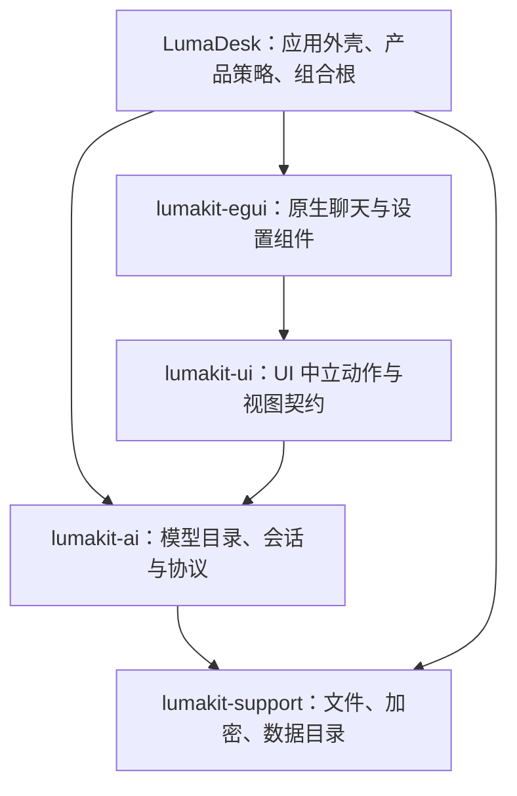

# AI 对话移植与 LumaKit 复用设计

状态：文本聊天移植与共享组件已实施，P4 其它设置组件提取未实施。日期：2026-10-23。实际接口、差异和验证边界见 [详细设计](02-AI对话移植详细设计.md)。

本文是源码阅读后的实施设计，不是完成记录。目标是让 LumaDesk 的聊天体验有明确的参考依据，并把通用成果沉淀进现有 LumaKit；不是把 Svelte 搬进 Rust，也不是再创建一套同名框架。

## 1. 决策与范围

1. 参考 AutoNote 实际使用的 `@ouraihub/aether-ui`，移植信息结构、交互约束和排版规则，原生绘制仍用 egui。
2. 先完成文本聊天的布局、消息排版、模型选择、历史、输入、复制、重试和状态反馈；不借 UI 改造一次性加入图片、工具、搜索、计费、翻译或分支。
3. 通用聊天模型与控制逻辑归 LumaKit；egui 组件独立放在计划新增的 `lumakit-egui`，不让现有 UI 中立层依赖 egui。
4. LumaDesk 只负责组合、主题和产品策略。预设服务商、邀请链接、应用页签、笔记上下文、导出到业务功能均由宿主决定。
5. 先完成可用的纵向链路，再用独立组件宿主证明可复用；不以一堆空 trait 或“后续可接入”占位作为框架成果。
6. 现有历史、模型设置、密钥和发布目录必须保留。框架提取本身不要求改历史文件格式。

最初设计阶段只交付本文；后续按详细设计实施会话核心、共享原生组件、产品接入与独立消费宿主，不改变现有 v1 数据格式。

## 2. 阅读依据与证据边界

### 2.1 来源约定

- `A/` = `E:/workspace/notepad-dev/AutoNote/`。
- `U/` = `A/node_modules/@ouraihub/aether-ui/src/`，是当前安装的实际组件源码，不是只看 AutoNote 包装层。
- `D/` = LumaDesk 项目根。
- `K/` = 相邻 LumaKit 项目根。

AutoNote `packages/app/package.json` 中的 UI 依赖固定到 Aether 提交 `84a643c6d97ded4c29b9b0a5c14adf534ff32d5c`。以下行号对应本次本地快照，后续改动以文件和符号为准。

### 2.2 已读关键路径

| 阅读对象 | 依据 | 本文采用的事实 |
| --- | --- | --- |
| AutoNote 宿主包装 | `A/packages/app/src/features/ai/chat/ChatPanel.svelte:14–66` | 按笔记生成 scope/context；记住会话、工具栏和思考设置；实际 UI 由共享组件提供 |
| 聊天布局 | `U/chat/ChatPanel.svelte:694–837,1398–1497` | 头部、可滚动消息、底部 composer 三段；历史通过头部弹窗进入 |
| 输入与工具栏 | 同文件 `901–919,1247–1270,1541–1554` | 输入和工具栏同容器；发送/停止互换；Ctrl/Cmd+Enter 排除输入法组合与重复按键 |
| 消息表现 | `U/chat/MessageItem.svelte:159–214,214–373,443–568` | 用户消息靠右；助手块含来源、正文、动作、终态；Markdown 有独立排版 |
| 会话状态 | `U/chat/run-session.svelte.ts:132–168,210–300,329–519` | 候选回答分组、取消、accepted/end、历史回读、过期事件守卫 |
| 模型选择 | `U/providers/ModelSelect.svelte:79–214,227–249` | 搜索、分组、能力过滤、失效模型状态；名称优先，分组信息弱化 |
| 端口与 DTO | `U/ports/contract.ts:51–92,127–137`；`generated/RunRequest.ts,RunEvent.ts,Turn.ts` | UI 不直接拥有业务存储；缺失能力可以不出现；每轮只有一个终态 |
| 样式 | `U/styles/tokens.css:3–10`；`A/packages/app/src/styles/{tokens,ui}.css` | 统一控件尺度，组件颜色映射到宿主主题，而非照用组件默认配色 |
| 当前原生聊天 | `D/src/chat.rs:12–95,109–276,278–488` | 数据、网络线程、保存和绘制混在同一组件 |
| 当前框架 | `K/crates/lumakit-ai/src/{lib,history,providers}.rs`；`lumakit-ui/src/{lib,ai}.rs`；`lumakit-support/src/{lib,sqlite}.rs` | 协议可复用；历史结构不一致；UI 契约尚未承载真正的聊天组件 |

已阅读的是上述关键路径与相关函数，不宣称完整逐行审计 Aether 所有功能。本次没有启动 AutoNote 做视觉对照，没有运行构建或测试；参考外观来自实际模板/样式，当前重叠来自用户截图，根因分析来自原生布局源码。实施时必须补实窗验收。

### 2.3 许可边界

已安装的 `@ouraihub/aether-ui/package.json` 没有 license 字段，包目录未找到 LICENSE；仅凭此不能确认上游完整授权条件。AutoNote 的许可也不能自动等同于 Aether 的许可。本文描述行为与设计事实，不复制组件实现。若实施中需要直接搬运代码、资源或文案，应先核对上游仓库许可及保留义务；不能因“可以读取”就认定可以按 LumaKit 的 MIT/Apache 声明重新发布。

## 3. 不是颜色不同，而是结构与职责不同

### 3.1 用户看到的重叠

`D/src/chat.rs:323–357` 在 `bottom_up` 布局中嵌套 `vertical`，再把 `available_height()` 交给消息 ScrollArea。输入区没有通过真正的底部面板从剩余消息矩形中扣除。`vertical` 本身又采用 top-down 子布局；egui 的 scope 在子内容完成后按实际 min_rect 推进父游标。

用户截图已经证明消息、占位文字和输入框覆盖。上述组合是需要替换的布局边界；具体每帧矩形变化尚未实测，不能把推测写成已复现的唯一触发条件。不是添加空白、调大 max_height 或裁掉文字就能解决的问题。

### 3.2 对照结果

| 层面 | Aether / AutoNote | 当前 LumaDesk | 移植决定 |
| --- | --- | --- | --- |
| 空间分配 | 消息填充余高，composer 不收缩 | 反向布局混合正向子布局 | 原生面板先分配头尾，余下给消息 |
| 会话导航 | 头部历史弹窗、新会话入口 | 常驻窄侧栏 | 改为历史弹窗，正文不再被二次分栏 |
| 角色区分 | 用户气泡与助手内容块 | 共用 label 渲染函数 | 分成两种消息呈现，不改消息正文 |
| 来源与操作 | 模型来源弱化，动作在回答后 | 尝试次数、状态、复制混在标题 | 来源、正文、状态、操作分层 |
| 正文 | Markdown，段落/代码/表格有节奏 | 普通 Label | 增加原生 Markdown，不引入 WebView |
| 模型 | 可搜索分组，名称/来源分层 | 长串路径式 ComboBox | 结构化 ModelOption 和分组搜索 |
| 输入 | 独立带边框容器，右侧发送/停止 | 输入、发送、重新生成混排 | 重试归回答；composer 只管新输入与停止 |
| 上下文 | 选择的候选及祖先链 | 每个问题只认最后一个 attempt，且必须完成 | UI 迁移先保留原规则；候选选择另作语义升级 |
| 框架 | 端口、状态、控件、宿主分离 | 组件直接依赖 ModelSettings 与文件 | 提取真实核心和原生适配层 |

特别注意：当前 `context()` 不是“从所有尝试中寻找最后成功项”，而是只检查 `attempts.last()`。末次重试失败时，之前成功的尝试不会进入后续上下文。移植时不得暗改为另一种选择规则。

## 4. 目标聊天设计

### 4.1 页面与空间合同

- 保留 LumaDesk 现有应用栏和页签；聊天区域内部不再保留永久历史侧栏。
- 头部第一行：会话标题，右侧历史、新对话；第二行：模型选择，设置入口纳入模型选择底部或紧邻但不抢宽。
- 中部：唯一消息滚动区域。空状态、模型无效提示和回答都在明确区域中显示。
- 底部：输入正文与工具栏组成单一 composer；占位高度先从聊天区域扣除。
- 错误/保存失败提示有独立可见位置，不作为消息区背后的浮层。

原生实现选择：在聊天 child Ui 内使用嵌套的 `TopBottomPanel::top/bottom(...).show_inside`，随后只在余下矩形放 transcript。不得再用反向 scope 模拟底部布局。面板 ID 按组件实例隔离；若内部误差必须手工分配矩形，仍由一个位置负责划分，不能两块分别猜测高度。

不变量：`header.bottom <= transcript.top`，`transcript.bottom <= composer.top`；所有区域都在宿主分配矩形内；输入区内部也不能让长错误提示挤掉发送按钮。

### 4.2 排版与尺度

下表的“参考”是 CSS 逻辑尺寸，“原生目标”是 egui 逻辑 point，不直接拿屏幕物理像素作等号。

| 项目 | 参考 | 原生目标 |
| --- | --- | --- |
| 正文字号 | 13px | 13pt 起，结合 Windows 字体实窗校准 |
| 辅助信息 | 12px | 12pt，模型来源/快捷键弱化 |
| 正文行高 | 1.6 | 明确行距，中文不依赖默认紧密行盒 |
| 控件高度 | 28–30px | 28–30pt，统一按钮/模型选择 |
| 轮次间隔 | 16px | 16pt |
| 助手块内边距 | 12px | 12pt |
| 用户块内边距 | 10px / 12px | 10pt / 12pt |
| 基础圆角 | 8px | 8pt；composer 12pt |
| composer 输入正文 | 默认 80px | 默认约 80pt，内容超长内部滚动 |
| 输入展开 | 容器高度 40% | 可展开到聊天可用高度约 40%，始终留出消息和工具栏 |

只维护一套语义主题值：正文、次级文字、背景、助手底、边界、强调色、错误色、焦点。复用宿主浅深色切换，不把 AutoNote 的所有主题色和皮肤选择器都复制进来。正文不能长期使用次级文字色；按钮必须有默认、悬停、焦点、按下、禁用状态。

### 4.3 消息与动作

- 用户：右对齐、有限宽度的主题色气泡，保留用户输入换行；长词允许断行。
- 助手：内容块左对齐，模型来源小字；正文占主位。完成状态不和每段内容竞争。
- 复制、重试/重新生成放在对应回答底部。仅末次问题提供当前后端支持的重试；不为旧问题绘制尚不能执行的按钮。
- 同问题的旧尝试折叠，显示来源与状态；当前展开项不代表拥有 Aether 的“选作上下文”功能。
- failed/cancelled 保留已收到文本；中断有明确标识。未完成流不得伪装成已完成。
- 普通回复、代码块、表格应允许选择与复制；复制仍返回原始 Markdown，不能是丢失格式的渲染文本。

### 4.4 Markdown

实现前评估兼容 egui 0.33 的成熟原生渲染器，检查许可、依赖和真实控件行为后选定；本文不伪造已经选型。优先一个现成渲染组件，不手写 Markdown parser，也不为此接入浏览器。

最低验收：标题、段落、粗体、列表、引用、链接、行内代码、代码块、表格、中文长文本、流式未闭合代码围栏。代码块/表格只在自身横向滚动，聊天区域不被撑宽。禁用原始 HTML、脚本、自动远程图片获取；链接点击仅允许 HTTP(S)，不自动打开模型返回的文件/命令 URI。保持源文本作为存储与复制的唯一来源。

已完成回答缓存渲染结果；流式只使当前回答失效。不允许每帧重新解析全部历史，也不为每个字符写文件。是否增加语法高亮在基本排版通过后再定，不影响本轮完成判据。

### 4.5 滚动、输入与状态

- 消息区与长输入框各自滚动，滚轮命中哪个区域就操作哪个区域。
- 在底部时跟随流式；用户向上阅读时停止追随，显示“回到底部”。点击后恢复跟随，不能用不可见的强制 scroll 每帧抢位置。
- 发送后跟随最新回复；新会话为空状态；重启恢复已选会话、草稿和模型，但不得把已发送问题又塞回输入框。
- Enter 换行，Ctrl+Enter 发送；输入法组合期间和按键自动重复不提交。当前 egui 对 IME 的具体事件映射需实施时验证，不宣称已有等价实现。
- 生成中发送位置变为停止，重复发送受状态守卫；停止到终态和落盘完成前不释放关键操作锁。
- 无模型、模型被停用/删除、历史载入失败、历史保存失败分别反馈；不把这些状态都降级为空白页。
- 关闭窗口先取消/收尾并完成保存；失败继续留在可恢复页面。普通切换应用不丢失正在生成的结果。

## 5. Aether 行为如何迁移，哪些不机械照搬

| 参考合同 | 本次文本聊天处理 | 有意差异或后续条件 |
| --- | --- | --- |
| run accepted 与 end 分开 | 保留“接受前持久化、运行后唯一终态” | 本地进程用稳定 attempt ID，不模拟 IPC 临时 ID 替换及远端历史对账 |
| 过期事件守卫 | 事件携带运行/attempt 身份，结束只应用一次 | 不能把过期输出写入当前选中的会话 |
| 重试保留原候选 | 保留现有 attempts 与源问题 | “使用该候选继续”、父链、分支需单独 schema 方案 |
| 重试模型快照 | 普通重试使用源尝试模型；更换模型重答必须显式 | 这是当前行为的修订，单独测试并向用户说明，不能随下拉选择悄悄变化 |
| 无效模型 | 显式提示并阻止请求 | 不静默换成列表第一项 |
| 缺能力不渲染 | 只展示已接通文本动作 | 工具/图片/思考/用量无真实事件就不绘制假入口 |
| 按 scope 恢复 | 保留独立会话 ID 与宿主恢复键入口 | LumaDesk 暂用单一聊天空间；笔记 ID 不进入通用组件 |
| 宿主插入/保存/导出 | 用明确的宿主动作返回值或回调 | 未提供动作就隐藏；不在框架内查找笔记数据库 |

候选选择升级不属于修复布局的先决条件。若后续决定完整对齐 Aether 的回答树，需要明确 `question/attempt/parent/selected` 关系、失效后代处理和旧会话上下文迁移，不能仅加一个 selected 布尔值假装有祖先链。

## 6. LumaKit 分层：可复用但不重新造平台

### 6.1 现状

- `lumakit-ai::stream_chat` 已经是三协议真实文本客户端；继续复用其取消、超时和 SSE 完成性判断。
- `lumakit-ui` 目前是 UI 中立契约，既没有 egui 依赖，也没有真正的聊天面板。
- LumaDesk 的 `_session: UiSession<Backend>` 没有参与聊天主链；`AiSettingsPort` 目前没有实现，不应宣称它已提供模块复用。
- `chat.rs` 同时拥有 schema、文件、线程、上下文和绘制；直接依赖具体 `ModelSettings`。
- 框架 `history::Turn` 与产品 `Turn/Attempt` 不同；不能直接换类型而丢失线路 ID、协议、草稿和重试分组。

### 6.2 目标依赖

`lumakit-egui` 是唯一计划新增的生产 crate，用来隔离 egui 版本和控件。渲染器只依赖 egui，不强制其它宿主使用 eframe；窗口和消息循环由 LumaDesk 拥有。CLI 不依赖这层。箭头是目标设计，不代表当前已经存在这些模块。

用户已经明确要求可复用成果，因此本次规划包含组件提取和消费验证，不把所有复用都无限推迟到“以后有第二个应用”。但仍不建立插件系统、动态装载、服务定位器或跨语言协议。

### 6.3 逐项归属

| 能力 | 目标归属 | 宿主保留内容 |
| --- | --- | --- |
| 三协议编码、SSE、HTTP 边界 | 现有 `lumakit-ai` | 选用哪条已保存线路 |
| 会话、问题、尝试、上下文和恢复 | `lumakit-ai::chat`，提取现有模型 | 数据根、应用生命周期 |
| 会话文件存储 | 同一 chat 模块的具体文件仓库，底层复用 support | 文件路径，不擅自选择 APPDATA |
| 无明文模型选项、可用状态 | `lumakit-ai` 的目录服务；UI 中立 DTO 在 `lumakit-ui` | 预设与启用策略 |
| 连接解析与密钥使用 | 目录服务/受控执行层；精确匹配 provider + endpoint + model + protocol | OS 密钥保护适配与授权策略 |
| 密钥封装与随机 ID | `lumakit-support`，移动已有实现 | 显示/复制需要的产品确认策略 |
| 会话 UI 状态、动作结果 | `lumakit-ui::chat`，仅真实需要的动作 | 打开设置、插入业务内容 |
| 聊天面板、消息、模型选择、历史弹窗 | `lumakit-egui` | 字体、主题值和实际嵌入位置 |
| 模型/搜索设置通用服务与控件 | 后续逐个迁入 `lumakit-ai` / `lumakit-egui` | 三家预设、链接、产品缺省值 |
| 笔记、知识库、工作、翻译业务 | LumaDesk | 不进入基础框架 |
| 日志/任务/存储接口 | 优先复用现有 crates | 不为了包名齐全重写一套任务系统 |

### 6.4 最小接缝，先用具体类型

以下是计划接口职责，不是现有可调用 API，也不是要求现在生成占位代码：

- `ChatSession`：接收提交、重试、停止、会话选择；归约有界事件；暴露借用的视图和未保存状态。不得接收 `egui::Context`。宿主注入 `Fn() + Send + Sync` 唤醒回调，egui 侧将其接到 request_repaint；CLI 可以使用空唤醒但必须主动消费事件。session 自己负责 cancel、poll、can_close 和退出时排空有界队列后回收线程，不能直接 join 一个被发送队列阻塞的 worker。
- `FileChatRepository::open(path)`：加载当前版本历史，保存接受记录与终态，提供保存失败恢复。先做一个实际实现，不抽泛型仓库工厂。
- `ModelOption`：稳定模型引用、显示名、服务商/线路标签、已有能力。不能含地址凭据或密钥；保存目录变化后更新，不每帧重新拼接全量标签。
- `ChatPanel::show(ui, view)`：只绘制与收集动作，返回 `ChatAction` 列表或单个动作；不持有 `ModelSettings`、密钥或文件路径。
- 宿主在绘制后处理动作并调用 session；网络 worker 只持有执行所需连接快照。UI 不通过读写同一个大锁与网络协作。
- 新增动作只包含当前已实现的会话、新建/删除、选择模型、提交、末次重试、停止、重试保存、打开设置；关闭是宿主生命周期动作，由 session 的 can_close/收尾结果仲裁。取消后到终态已保存才允许关闭；Drop 的最后保存是兜底，不能代替可恢复的正常关闭流程。

P1 就建立一个实际使用的小模型来源接缝：提供无密钥的模型选项，以及 `resolve(&ModelRef) -> Result<AiConnection, ...>`。LumaDesk 的实现来自已有已保存配置，独立验收宿主也通过此接缝提供真实回环连接；两者不导入彼此源码。可用两个函数回调，不必先造 trait 层级。P1 分离目录服务及密钥使用边界；P4 才迁移设置编辑器、凭据管理界面和搜索模块，不再把目录核心拖到 P4。

跨层错误用结构化代码加显示详情，不按英文报错字符串判断状态，也不把上游原始错误直接作为未来业务逻辑协议。

### 6.5 提取与删除必须同批完成

- 移出一个能力就迁移 LumaDesk 的所有实际调用者，删除产品内旧副本；不留两个 history 或两套 search executor 同时维护。
- 不为了“证明使用框架”继续保留未参与请求的 `_session` 和空 Backend。核对示例调用者后接通或移除，不能盲删整个公共 API。
- `ProviderStore` 的现有 provider 单密钥/按模型解析，不满足线路多密钥身份；不能仅改名接线。提取真实目录数据模型并迁移调用者后再处理旧接口。
- 框架示例当前不在 workspace members，且桌面示例引用了未声明的 `eframe.workspace`；它不能直接充当“第二宿主已通过”的证据。实施时需先修正并纳入检查，或建立独立可运行组件验收宿主。

## 7. 数据与安全：提取不能导致资料丢失

### 7.1 保持 schema v1 的纯提取

当前文件名仍为 `chat-history.json`，封装仍为 `schemaVersion: 1`，字段包括 conversations、selected、model，以及 conversation.draft、turn.input、attempts。将 Rust 类型移动到框架不改变序列化名称、状态值、ID、顺序和模型身份。

模型与搜索文件各自迁移，不能用“框架默认配置”覆盖用户配置；服务商预设由宿主传入，保留一次性初始化规则。DPAPI 密文仍绑定原 Windows 用户，不承诺复制到另一账号后可解密。

移动 `SavedKey`、`ModelRef`、`Protocol` 时保持现有 JSON 字段、类型与枚举拼写的线格式兼容：尤其 `{id, masked, ciphertext}` 不新增必填字段，不改密文字节，不改变 Protocol 的 serde 表示。验证 model/search/chat 三份旧文件的语义及密文字节读回；不要求 JSON 空白或字段顺序相同。`lumakit-support` 目前没有 zeroize/getrandom 依赖，移动密钥/ID 实现时应显式复用 workspace 的已有依赖，不遗漏依赖声明。

### 7.2 涉及语义变化时才升版本

候选选择、父链、按 scope 归档若改变持久化意义，另加 v1→v2 显式转换：

1. 先按 v1 解析并校验；未知版本不覆盖。
2. 备份原字节，构造新文件，校验引用完整性。
3. 保持问题/尝试 ID、正文、状态、模型和草稿；不能按成功项过滤掉失败历史。
4. 默认上下文必须等价于旧算法，不自动复活旧算法排除的成功候选。若要采用不同规则，给出单独产品决定。
5. 替换成功才切换，失败原文件仍可读；迁移重复执行不重复新增。

不能直接采用现有 `lumakit-ai::history::HistoryStore` 文件，因为它的裸 JSON、扁平 Turn、model 字符串与产品文件不兼容。该模块的保留、迁移或删除要先查全部调用者，不能偷偷作为另一个生产存储入口。

### 7.3 需要先处理的风险

| 风险 | 源码依据 | 实施要求 |
| --- | --- | --- |
| 开始前保存失败后，问题已加入内存且草稿恢复，重发可能重复 | `D/src/chat.rs:117–123,186–211` | 接受事务失败撤回本次新增 turn/attempt，恢复原草稿；已有记录不动 |
| 旧框架历史 Windows 先删旧文件再 rename | `K/crates/lumakit-ai/src/history.rs:239–250` | 若该 API 保留，删除预先 remove_file 的做法并复用安全替换；在旧文件仍存在时完成写入与替换，替换失败原字节不动 |
| versioned 保存使用固定 tmp 名，rename 前无同步 | `K/crates/lumakit-support/src/lib.rs:50–64` | 同一仓库单写者；唯一临时名，写完先 File::sync_all 再替换，错误传播并清理自有临时文件；不把原子可见误称为绝对断电保证 |
| UI 中立契约缺线路/多密钥身份 | `K/crates/lumakit-ui/src/ai.rs:7–20,47–61` | 不将密钥列表公开给视图；精确引用线路，明确失效状态 |
| AiHost 默认把 endpoint 当 URL | `K/crates/lumakit-ai/src/lib.rs` 的 `AiHost::connection` | P1 查全部实现与调用后取消危险默认实现，要求真实目录解析；逐个迁移宿主和示例，禁止把线路 ID 当地址 |
| 便携目录不可写后静默回退位置 | `K/crates/lumakit-support/src/lib.rs:31–47` | LumaDesk 采用明确的便携路径策略；失败解释，不以新空历史掩盖问题 |
| 全量文件序列化/每帧模型标签构建 | `D/src/chat.rs:85–95,287,304`、`D/src/model_settings.rs:478–485` | 去掉每帧全量复制；JSON 暂保留，量测证明保存阻塞后才迁移 SQLite |

这些是源码风险分析，不是本次新复现的运行结果。并发写保护应解决真实单实例/多实例所有权问题；唯一 tmp 文件本身不解决两个进程覆盖同一历史。首轮采用一份历史只有一个写入实例，第二实例需明确拒绝或只读，不承诺多窗口实时同步。

## 8. 分阶段实施与退出条件

所有阶段维持可运行应用。P0–P3 的文本主链已实施；多种真实系统 DPI 与 IME 组合的人工验收不宣称全覆盖，准确范围见详细设计第7节。P4 尚未实施。

### P0 — 确认设计与兼容基线

- [x] 确认本文范围：文本聊天体验对齐 + 框架化，不等同 Aether 所有业务能力。
- [x] 使用无真实密钥的 v1 隔离历史与设置样本验收，烟测后清理。
- [x] 补原生布局矩形记录，覆盖用户截图场景；不重跑用户操作来“证明截图是真的”。
- [x] 自主实现参考行为；新增 Markdown 依赖已核对许可，不复制上游组件代码。

退出条件：UI 目标、数据不变量、修改文件计划可供实施审阅。

### P1 — 提取最小真实会话核心

- [x] 在 `lumakit-ai::chat` 提取问题/尝试、context/recover、具体文件存储、接受/终态控制；保留 v1。
- [x] 修复保存失败重复与共享写盘风险；持有内核单写者锁。
- [x] 模型目录从设置控件分离，精确解析已保存身份；取消危险默认连接实现。
- [x] UI 中立视图/动作、宿主唤醒、关闭仲裁和排空队列已接入。
- [x] LumaDesk 改用真实核心；旧副本与空接线已移除。

退出条件：无界面脚本也能执行三协议多轮、失败、停止、重试和重启恢复；现有用户文件无损读回。

### P2 — 实现原生聊天组件并修复布局

- [x] 新增 `lumakit-egui`，egui 与宿主 eframe 同为 0.33.3，不依赖 LumaDesk。
- [x] 头部、历史弹窗、独立 transcript/composer、角色消息块、回答动作与模型搜索已实施。
- [x] 接入 egui_commonmark，完成安全/长内容检查与实窗 Markdown 观察。
- [x] 文本动作、源模型重试与显式换模型重答已接通。
- [x] 宿主主题/字体注入，旧尝试、错误与保存恢复已保留。

退出条件：实际窗口与布局回归通过；2倍DPI逻辑布局已覆盖，所有系统DPI及真实IME组合不宣称人工全验，准确边界见详细设计。

### P3 — 证明框架真的能复用

- [x] 独立 `lumakit-chat-host` 使用同一 ChatPanel/Core，不导入产品源码。
- [x] 独立宿主完成真实回环 HTTP 请求与 Markdown 回复观察。
- [x] 组件实例状态隔离与写锁释放/拒绝重复写入检查通过。
- [x] CLI 无 egui 依赖并完成真实流式请求，组件宿主无需业务页签或笔记库。

退出条件：用户可以在另一个宿主中消费同一套聊天能力，而不是复制 chat.rs。

### P4 — 逐项沉淀其它基础能力

- [ ] 在 P1 已分离的服务商目录/密钥使用服务之上迁移模型设置组件与凭据管理界面；产品预设保留宿主注入。
- [ ] 搜索设置/执行服务合并目前宿主与框架的重复实现，保留结构化 HTTP 状态和黑名单语义。
- [ ] 日志、取消与关闭、设置基础控件优先接通既有 crates，再决定是否提取新组件。
- [ ] 每提取一个模块，都用产品调用和独立消费验收，不一次生成全部接口。

此阶段是基础框架建设清单，不属于首轮聊天 UI 修复必须顺带完成的功能。图片、skills、MCP、reasoning、用量、价格、回答树作为独立功能设计，不能因 Aether 有就默认纳入。

## 9. 文件级计划

| 文件/目录 | 计划改动 | 本轮是否修改 |
| --- | --- | --- |
| `D/src/chat.rs` | 从全功能控制器改为组件组合/动作转发，移除被提取副本 | 否 |
| `D/src/model_settings.rs` | 分离目录与设置绘制，去掉每帧标签重建 | 否 |
| `D/src/main.rs` | 注入真实 session、主题、设置动作和关闭安全门 | 否 |
| `D/Cargo.toml` | 消费共享组件及实际依赖，去掉失效接线 | 否 |
| `K/crates/lumakit-ai/src/chat/` | 提取真实会话核心和仓库 | 否 |
| `K/crates/lumakit-ui/src/chat.rs` | UI 中立视图与动作，按真实使用增长 | 否 |
| `K/crates/lumakit-egui/` | 计划唯一新增生产 crate，承载原生绘制 | 否 |
| `K/crates/lumakit-support/` | 复用已有加密/存储，修写入与路径策略 | 否 |
| `K/examples/`、workspace 清单 | 可运行消费验收，修正已有示例声明 | 否 |
| `D/scripts/check.bat,build-app.bat` | 检查覆盖新组件与核心，仍输出 dist | 否 |
| `D/docs/01-AI对话移植与LumaKit复用设计.md`、README | 方案与入口 | 是 |

每阶段涉及公共导出变化时，先查引用，迁移真实调用者和对应行为测试，不保留长期兼容别名。现有产物和用户 data 不因设计阶段变化。

## 10. 验收矩阵

| 类别 | 必须覆盖 | 证据 |
| --- | --- | --- |
| 布局 | 860×560、1200×800、窄高、宽矮；100/125/150/200% DPI | 实窗截图 + header/transcript/composer 实际矩形不相交 |
| 内容 | 空会话、短问答、多轮、长中文、长 URL、代码/表格、长草稿、超长错误 | 正文不撑宽；工具栏可操作；独立滚动 |
| 输入 | Enter、Ctrl+Enter、中文 IME、长按、空输入、模型失效 | 不误发/重复发；草稿正确保留 |
| 流式 | 逐段增长、主动停止、网络错误、缺终止帧、Responses incomplete | 部分可见，终态唯一，失败不记成功 |
| 重试 | 源模型失效、源模型重试、明确换模型重答、重试失败 | 原尝试保留；上下文不重复；规则与设计一致 |
| 保存 | 发送前失败、结束保存失败、崩溃恢复、关闭时失败、v1 读回 | 未接受不联网；原数据仍在；重试不重复问题 |
| 滚动 | 底部跟随、上翻阅读、回到底部、输入框滚动 | 不抢阅读位置，不把消息滚轮用于输入框 |
| 主题与可达性 | 浅/深色、焦点、禁用、生成、失败、复制反馈 | 正文对比度合格；键盘能到达关键动作 |
| 复用 | LumaDesk + 独立消费宿主 + CLI 核心 | 无反向依赖；无重复业务实现；不靠复制源码 |
| 发布 | `scripts/build-app.bat`、release.json、ZIP、现有 data | EXE/包内哈希一致，重打包不改资料 |

行为测试只覆盖实际边界和状态，不测试组件名、转发次数或源代码文本。布局检查必须来自实际 egui 计算结果，不把手写坐标断言当成真实布局证明；截图是视觉证据，测试不能替代。

## 11. 完成定义与当前结论

文本聊天移植完成 = P1、P2、P3 的退出条件全部满足，并在正式 dist 程序观察到正确布局。框架可复用完成 = 独立宿主能使用相同能力且 LumaDesk 旧副本已移除。P4 每项单独验收，不能整体提前勾选。

当前已经提取 ChatSession、模型目录、凭据/安全存储与 ChatPanel；产品和独立宿主均完成真实回环 HTTP 验收，正式 dist 程序已观察消息/输入分区。候选树、其它业务能力与设置全面组件化仍不在本次交付范围。
